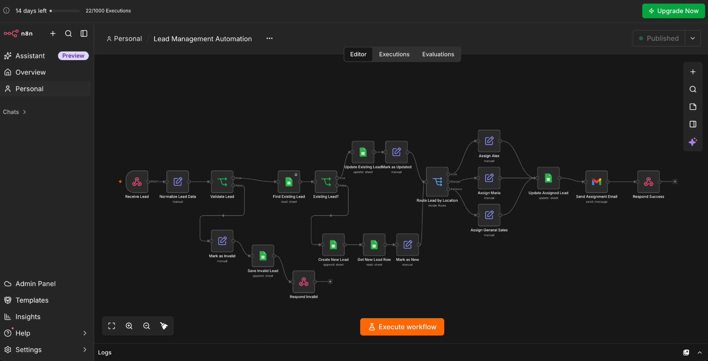
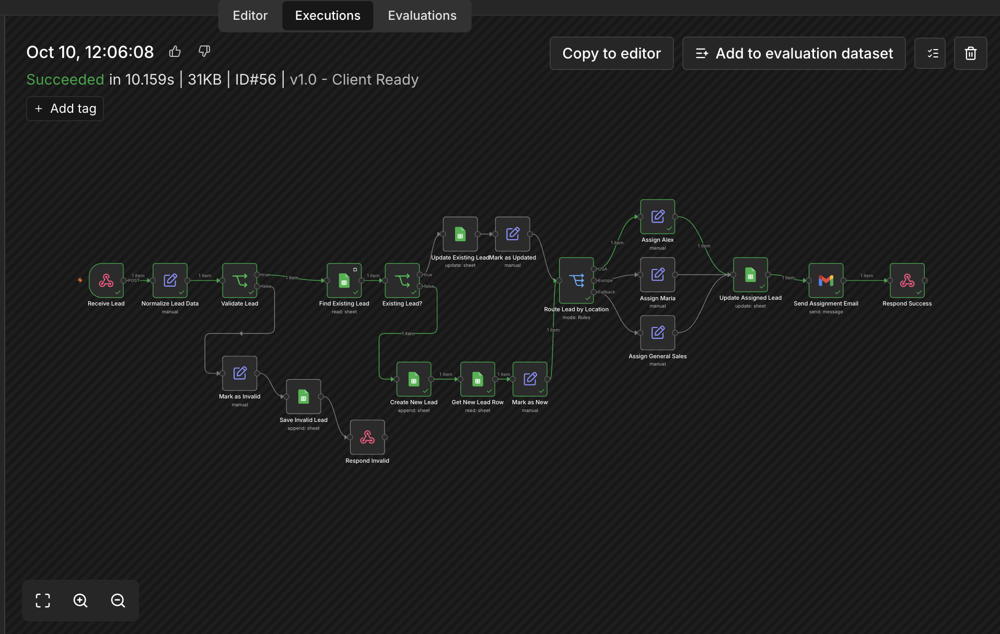
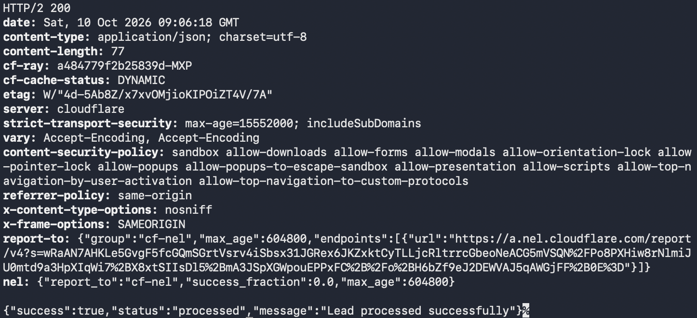
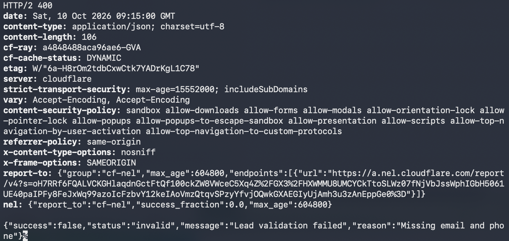
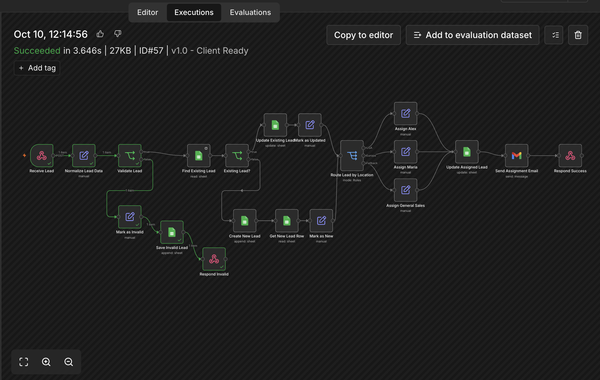

# Lead Management Automation with n8n

A production-style lead management workflow built with n8n.

The automation receives leads through a webhook, validates incoming data, checks for existing leads, stores or updates records in Google Sheets, routes leads to the appropriate sales representative, sends email notifications, and returns structured API responses.

## Workflow

Lead received via Webhook

- Normalize lead data
- Validate required contact information
- Check for an existing lead
- Create a new lead or update an existing one
- Route the lead by location
- Assign a sales representative
- Update Google Sheets
- Send an assignment email
- Return a structured API response

Invalid leads are stored separately and receive an HTTP 400 response.

## Features

- Webhook-based lead intake
- Lead validation
- Duplicate detection by email or phone
- Create or update lead records
- Google Sheets integration
- Location-based lead routing
- Automatic sales representative assignment
- Gmail notifications
- Separate invalid lead handling
- HTTP 200 success responses
- HTTP 400 validation responses
- Production-style error handling architecture

## Routing Example

The demo workflow uses the following routing logic:

- USA -> Alex
- Europe -> Maria
- Other locations -> General Sales

The routing rules can easily be customized for different businesses.

## Technology

- n8n
- Google Sheets
- Gmail
- Webhooks
- REST / HTTP
- JSON

## Screenshots

### Workflow Overview



### Successful Execution



### Successful API Response



### Invalid Lead API Response



### Invalid Lead Execution



## Example Webhook Request

```bash
curl -X POST "YOUR_N8N_WEBHOOK_URL" \
-H "Content-Type: application/json" \
-d '{
  "name": "John Smith",
  "email": "john@example.com",
  "phone": "+15550100001",
  "source": "Website",
  "location": "USA",
  "message": "Interested in your service"
}'

```
### Success Response

```json
{
  "success": true,
  "status": "processed",
  "message": "Lead processed successfully"
}
```

### Validation Error Response

```json
{
  "success": false,
  "status": "invalid",
  "message": "Lead validation failed",
  "reason": "Missing email and phone"
}
```

## Setup
1. Import lead-management-public-demo.json into n8n.
2. Connect your Google Sheets account.
3. Connect your Gmail account.
4. Replace YOUR_GOOGLE_SHEET_ID with your own Google Sheet ID.
5. Configure the Leads and Invalid Leads sheets.
6. Update the sales representative names and email addresses.
7. Publish the workflow.
8. Use the production webhook URL to send leads.

## Required Google Sheets Structure

### Leads

Recommended columns:

- name
- email
- phone
- source
- location
- message
- created_at
- updated_at
- assigned_to
- assigned_email
- status

### Invalid Leads

Recommended columns:

- name
- email
- phone
- source
- location
- message
- created_at
- updated_at
- status
- invalid_reason

## Public Demo

This repository contains a sanitized public version of the workflow.

Credentials, private Google Sheet IDs, instance-specific IDs, and production configuration are intentionally excluded.

The workflow is designed to demonstrate the architecture and automation logic while allowing users to connect their own services.

## Use Cases

This type of automation can be adapted for:

- Sales lead management
- Website contact forms
- Facebook lead forms
- CRM intake workflows
- Customer inquiry routing
- Agency lead distribution
- Internal sales operations

## Author

Built as part of an AI & Business Automation portfolio project.